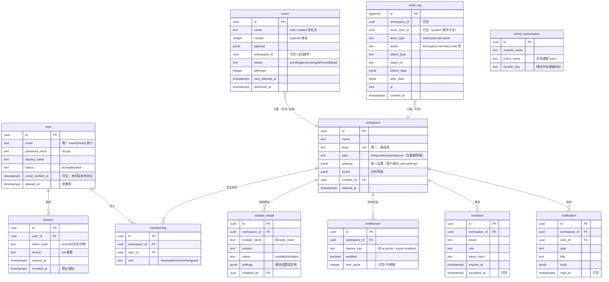

# ADR-0005：阶段 2 平台内核设计（数据模型 + 模块协议 + 事件总线）

- 状态：已接受（用户于 2026-10-31 确认，三项拍板点全部同意）
- 日期：2026-10-31
- 关联：AGENTS.md §2/§5（架构铁律）；ADR-0001/0002/0003；总体设计文档第七节阶段 2

> 用户于 2026-10-31 回复"确认"：scrypt、slug 路由、at-least-once 三项决策全部通过。

## 1. 目标与范围

**交付**：账号认证、工作空间（租户）+ RBAC、模块系统（manifest + 生命周期）、事件总线（outbox）、审计日志、通知中心、统一设置与特性开关、任务队列接入、文件服务接口、packages/sdk 模块开发工具集、《如何开发一个模块》文档，以及**验收用示例模块**。

**不交付**（后续阶段）：OAuth/Passkey 登录（本阶段邮箱密码 + 会话）、全局搜索、AI 能力、计费实现（仅 entitlement 数据结构）。

## 2. 数据库 Schema 规划

- `platform` schema：内核自有表（阶段 0 已建立）。
- 业务模块将来各自使用 `modules.<name>` schema（如 `modules.todo_notes`），通过模块迁移自建，互不越界。
- 命名约定：单数表名（`workspace` 而非 `workspaces`）；全部业务表带 `workspace_id`（除 user/session 等全局身份表）；全部时间戳 `timestamptz`；软删除用 `deleted_at`（删除 = 置空值，回收站阶段 3 做 UI）。
- 主键：uuid（`gen_random_uuid()`，PG18 内置，无需扩展）。citext 扩展不引入（embedded 发行版可用性不确定）——email 用 `text` + 唯一函数索引 `lower(email)`。

## 3. 数据模型（ER 图）



**关键索引**：全部 `workspace_id` 单列索引；`event(status, next_attempt_at)`（派发器扫描）；`event_subscription(module_name, event_name)`；`audit_log(workspace_id, created_at DESC)`；`session(token_hash)` 唯一；`membership(workspace_id, user_id)` 唯一。

**首迁移**：一次迁移建齐以上全部表（阶段 2 只建内核表，不改已有 `boot_markers`）。

## 4. 租户隔离：两道防线

1. **应用层（第一道）**：所有仓储/服务查询强制携带 `workspaceId` 条件——通过 Drizzle 仓储基类实现，业务代码拿不到"无租户"连接对象。
2. **RLS（第二道兜底）**：全部带 workspace_id 的表启用 `ENABLE ROW LEVEL SECURITY`，策略形如：

```sql
CREATE POLICY tenant_isolation ON platform.module_install
  USING (workspace_id = current_setting('app.workspace_id', true)::uuid);
```

API 每个请求在事务内 `set_config('app.workspace_id', <id>, true)`（事务级，随连接归还自动清除）。user/session 等全局表不设 RLS（走应用层 + 认证中间件）。**越权测试两道各一组**（阶段 2 验收标准）。

## 5. 认证与会话

- 邮箱+密码：**Node 内置 `crypto.scrypt`**（N=16384, r=8, p=1）——零新依赖、OWASP 认可；格式 `scrypt$N$r$p$salt$hash` 便于未来迁移 argon2（不引入原生模块依赖，避免 Windows 编译风险）。
- 会话：128bit 随机令牌 → 明文放 HttpOnly+SameSite=Lax Cookie，sha256 后存库；登录限流（内存计数：同 IP 5 次/分钟，超出延迟响应）；登出 = revoked_at。
- 邮箱验证与找回密码：本地开发"邮件适配器"输出到日志（邮件收发进收件箱前先落终端），生产接 SMTP 适配器（阶段 8）。
- OAuth / Passkey：不实现，表结构不预设依赖。

## 6. 权限模型 RBAC

- 角色：`owner`（转让与删除工作空间）、`admin`（管理成员/模块/设置）、`member`（业务读写）、`guest`（只读）。
- 权限点字符串：`<资源>:<动作>`。内核点：`workspace:manage`、`member:manage`、`module:manage`、`audit:read`、`notification:read`；模块点：`todo:read` / `todo:write` 等，由 manifest 声明。
- 角色→权限映射集中一处（`packages/core` 导出），代码里只问 `can(actor, 'todo:write')`，禁止散落 if-else 角色判断。

## 7. 模块协议（manifest）

```ts
// packages/sdk 导出，zod 校验
interface ModuleManifest {
  name: string; // 'todo_notes'，即 schema 名
  version: string; // semver
  title: string;
  description: string;
  icon?: string; // 内置图标名（阶段 3 定清单）
  permissions: string[]; // 声明所需权限点（启用时向用户展示）
  dependsOn: string[]; // 依赖的其他模块，启用时自动解析顺序
  routes: Array<{
    // 前端路由（已启用才挂载）
    path: string; // '/todo'
    component: string; // web/ 内组件导出名（动态 import）
    title: string;
    nav?: { order: number; icon?: string };
  }>;
  widgets?: Array<{
    // 首页小组件
    id: string;
    title: string;
    component: string;
    span: 1 | 2 | 3;
  }>;
  settings?: Array<{
    // 模块设置页字段（类型化渲染）
    key: string;
    label: string;
    type: 'text' | 'number' | 'boolean' | 'select';
    default?: unknown;
    options?: Array<{ value: string; label: string }>;
  }>;
  events: { publishes: string[]; subscribes: string[] }; // 订阅用通配
  migrations: string; // 相对目录名，模块自管
}
```

- 模块目录（`modules/<name>/`）：`manifest.ts` + `server/`（NestJS 子模块：controller/service，经内核上下文拿 db/queue/storage）+ `web/`（组件，动态挂载）+ `migrations/`（drizzle，独立 schema）+ `tests/`。
- **生命周期**：安装=写 `module_install`+跑该模块迁移；启用/停用=改 status（停用不删数据，前端路由/菜单即时消失）；依赖模块停用时禁止（提示先停依赖方）。内核对模块内容零感知，只在注册表里记录。
- 模块 server 代码通过 `ModuleContext`（packages/sdk 提供接口）访问：`ctx.db`（已绑定租户与模块 schema）、`ctx.events.publish/subscribe`、`ctx.storage`、`ctx.queue`、`ctx.settings`、`ctx.can()`。**禁止直连 pg / 直读他模块表**（架构铁律，代码评审项）。

## 8. 事件总线（outbox）

- 写路径：业务数据与 `event` 行**同事务**落库（不丢的第一保证）。
- 派发器：API 进程内 worker，每 2s `SELECT ... WHERE status='pending' AND next_attempt_at<=now() ORDER BY created_at FOR UPDATE SKIP LOCKED LIMIT 20`（多实例安全），按 `event_subscription` 匹配（精确 + `*` 通配），在**同一事务内**调用订阅模块 handler 并标记 delivered；handler 抛错 → attempts+1、退避 `5s*2^n`、超 max_attempts(8) → `dead`。
- 幂等要求：handler 必须幂等（投递语义 = at-least-once）；事件 payload 带 `eventId` 供去重。
- 命名：`<模块>.<实体>.<动作>`（`todo.created`、`todo.completed`）；payload 结构变更必须升 `version`。
- 通知中心：订阅内核事件（如 `member.invited`）+ 模块事件，写 `notification` 表；邮件适配器接口同上（本地打印）。
- 审计：NestJS 全局 interceptor 自动记录所有写操作（POST/PUT/PATCH/DELETE）的 before/after；服务层也可显式记更细粒度事件。

## 9. API 面（/v1）

```
POST /v1/auth/register | login | logout      GET /v1/auth/me
GET  /v1/workspaces             POST /v1/workspaces
GET  /v1/workspaces/:slug/members            POST .../members/invite
PATCH .../members/:userId (角色)             DELETE .../members/:userId
GET  /v1/workspaces/:slug/modules            POST .../modules/:name/enable|disable
PUT  .../modules/:name/settings
GET  /v1/workspaces/:slug/audit              GET /v1/notifications
GET  /v1/settings / PUT /v1/settings         （用户级）
```

统一响应 `{ data, error? }`；错误码 `atlas.<域>.<原因>`；输入全部 zod 校验（DTO 管道）。

## 10. 交付拆分（确认后逐步实现，每步一个提交序列）

| 步骤 | 内容                                                                        | 验收                                   |
| ---- | --------------------------------------------------------------------------- | -------------------------------------- |
| 2a   | 迁移（全部表）+ RLS + 认证（注册/登录/会话/限流）+ 工作空间 + 成员邀请      | 越权测试（应用层）绿                   |
| 2b   | 模块系统：manifest zod、注册/启停/依赖解析、ModuleContext、前端动态路由挂载 | 示例模块零内核改动启停；RLS 越权测试绿 |
| 2c   | 事件总线 outbox + 审计 interceptor + 通知中心                               | 重启不丢事件；审计覆盖全部写接口       |
| 2d   | SDK 文档《如何开发一个模块》+ 示例模块完善 + 覆盖率 ≥80% + 阶段验收         | 全部质量门绿 + 浏览器走查              |

## 11. 风险与取舍

- **RLS × 连接池**：set_config 必须事务级（第三参 true），连接归还自动复位；测试覆盖"归还后残留"用例。
- **embedded PG 的 contrib 扩展**：不依赖 citext/pg_trgm（阶段 4 全文检索时再验证）；uuid 用内置 `gen_random_uuid()`。
- **进程内派发器**：单实例开发足够；多实例部署（阶段 8）改为 BullMQ 消费同一 outbox 表，接口不变。
- **事件 schema 演进**：payload 带 version，消费方按版本分支；破坏性变更升事件名。
- **工作量表**：本阶段是全项目最大单体阶段，按 2a–2d 分步验收，任何一步不绿不进下一步。

## 12. 需要你拍板的 3 个点

1. 密码哈希用 **scrypt（内置零依赖）** 而非 argon2（原生模块）—— 同意吗？
2. 工作空间路由用 **slug**（如 /w/atlas/...）而非 uuid，URL 可读 —— 同意吗？
3. 事件投递语义 **at-least-once + handler 幂等**（而非 exactly-once，后者需要额外去重表）—— 同意吗？

## 13. 实现记录（2a，2026-10-31）

2a（迁移 + RLS + 认证 + 工作空间）已交付，集成测试在真实内嵌 PostgreSQL 上全绿。实现过程中踩到四个多租户 RLS 的经典深坑，全部已修复并有测试锁定：

1. **INSERT ... RETURNING × STABLE 函数快照**：RETURNING 要求新行同时通过 SELECT 的 USING 检查，而 STABLE 函数的快照看不到本语句刚插入的行 → workspace 的 USING 增补 created_by 分支（创始人天然可见自己刚建的空间）。
2. **current_setting(missing_ok=true) 返回空串**：''::uuid 直接抛 22P02 → 所有策略统一 NULLIF(current_setting(...), '')::uuid。
3. **全局唯一索引 × RLS**：slug 唯一索引跨租户生效，租户 SELECT 预检查看不见别人的行 → 改为捕获 23505 + 后缀重试（同时防并发竞态）。
4. **入会前的特权流程**：受邀者尚未成为成员，RLS 天然拦住 acceptInvitation → 走显式管理员连接（ADMIN_DB_TOKEN），由一次性 token + 邮箱精确匹配 + 审计日志保证安全。

其余实现约定：

- 所有 Nest 注入一律显式 @Inject(token)（vitest/esbuild 不产出装饰器元数据），见 apps/api/src/tokens.ts。
- withUser(db, userId, fn)：事务级 set_config（'app.user_id'），连接归还自动清除；RLS 策略以 app.user_id 为准（设计稿中的 app.workspace_id 实现时简化掉了——策略全部按用户集合判定，无需第二变量）。
- 邮箱写入时应用层小写归一化（不用 citext）。
- 集成测试基座：vitest globalSetup 在 5433 拉起独立内嵌 PG（.local/pgdata-test），迁移后 TRUNCATE 保证幂等。
- slug 冲突处理：捕获 23505 + 随机短尾重试 5 次。
